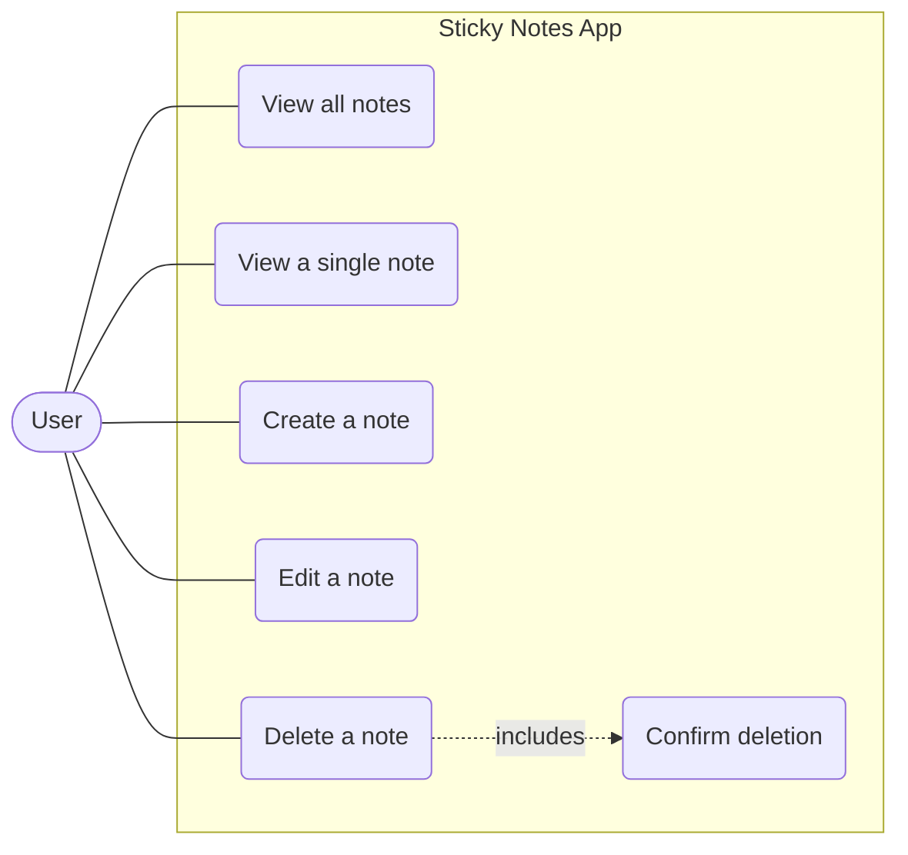
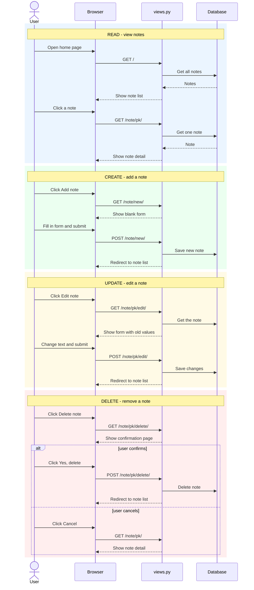
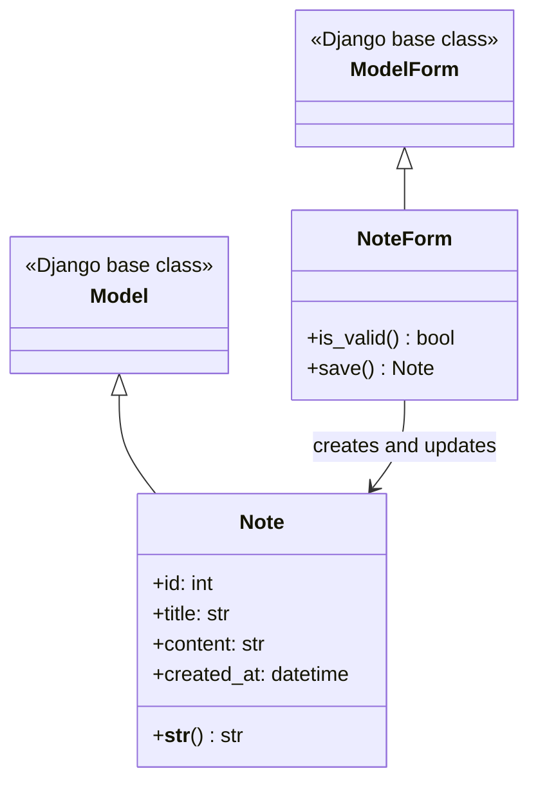

# Sticky Notes Design Diagrams

Mermaid source. Paste each block (without the backticks) into
https://mermaid.live and export a PNG.

## Use case diagram

## Sequence diagram (all CRUD use cases)

## Class diagram

